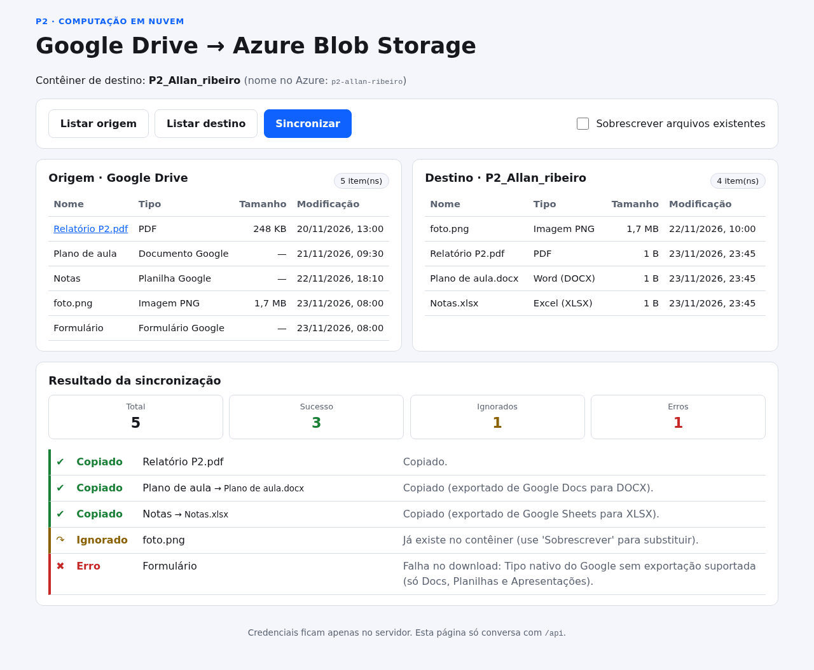

# Cloud-P2 · Google Drive → Azure Blob Storage

Aplicação web full stack da P2 de Computação em Nuvem. Ela:

1. lista os arquivos de uma pasta do Google Drive;
2. lista os blobs do contêiner Azure **`P2_Allan_ribeiro`**;
3. copia os arquivos do Drive para o Blob Storage;
4. mostra na tela **e** no console do servidor o resultado de cada transferência;
5. é publicada no Render como **um único Web Service**, com uma só URL (API + frontend).



> ⚠️ **Nunca envie segredos ao GitHub.** `.env`, `secrets/` e arquivos de chave já estão no `.gitignore`.
> A chave da Service Account e a Connection String do Azure ficam **só** em variáveis de ambiente
> (arquivo `.env` local ou *Environment* do Render). O frontend nunca recebe credenciais.

## Estrutura

```text
client/                         # React 19 + Vite 7 (página única em português)
  index.html
  vite.config.js                # proxy /api -> http://localhost:3000 em desenvolvimento
  src/
    App.jsx                     # botões, checkbox, estados de carregamento, erros
    api.js                      # chamadas relativas /api/*
    components/FileTable.jsx    # tabelas de origem e destino
    components/SyncResults.jsx  # resumo e status visual por arquivo
    App.test.jsx                # testes da interface (Vitest + happy-dom)
server/
  src/
    config/env.js               # leitura e validação centralizada do ambiente
    services/googleDriveService.js
    services/azureBlobService.js
    services/syncService.js
    routes/api.js               # /api/health, /api/source, /api/destination, /api/sync
    utils/errors.js             # erros seguros e remoção de segredos dos logs
    app.js                      # Express: CORS, API e build do React
    server.js                   # inicialização (0.0.0.0:$PORT)
  tests/                        # testes do backend com mocks (sem credenciais reais)
.env.example  eslint.config.js  vitest.config.js  render.yaml  package.json
```

## Pré-requisitos

- **Node.js 20.19+** (recomendado 22, veja `.nvmrc`) e npm.
- Um projeto no Google Cloud com a **Google Drive API** ativada e uma **Service Account** com chave JSON.
- A pasta do Drive **compartilhada com o e-mail da Service Account** (permissão de Leitor basta).
- Uma **conta de armazenamento** no Azure e a sua **Connection String**.

## Instalação e execução local

```bash
npm install
cp .env.example .env        # no Windows (PowerShell): Copy-Item .env.example .env
# edite o .env (veja a próxima seção)
npm run build               # gera client/dist
npm start                   # http://localhost:3000 (API + interface)
```

Desenvolvimento com recarga automática, em dois terminais:

```bash
npm run dev          # backend em http://localhost:3000 (node --watch)
npm run dev:client   # frontend em http://localhost:5173, com proxy de /api para o backend
```

## Criando o `.env`

| Variável | Obrigatória | O que é |
|---|---|---|
| `PORT` | não (3000) | Porta do servidor. O Render define sozinho. |
| `GOOGLE_DRIVE_FOLDER_ID` | sim | Só o ID da pasta: em `https://drive.google.com/drive/folders/ABC123`, é `ABC123`. |
| `GOOGLE_SERVICE_ACCOUNT_JSON_BASE64` | sim* | O JSON da Service Account em Base64, numa linha. É decodificado só em memória. |
| `GOOGLE_APPLICATION_CREDENTIALS` | sim* | Alternativa local: caminho do JSON, por exemplo `./secrets/service-account.json`. |
| `AZURE_STORAGE_CONNECTION_STRING` | sim* | Portal do Azure → conta de armazenamento → *Chaves de acesso* → Connection string. |
| `AZURE_STORAGE_SAS_URL` | sim* | Alternativa à Connection String: URL SAS da conta de armazenamento, somente no backend. |
| `AZURE_STORAGE_CONTAINER` | não | Padrão `P2_Allan_ribeiro` (veja a nota sobre o nome abaixo). |
| `CORS_ORIGIN` | não | Origem liberada em desenvolvimento (`http://localhost:5173`). Aceita várias, separadas por vírgula. |

\* Para Google, use uma das duas opções de credencial; se ambas existirem, vale a Base64. Para Azure, use uma Connection String ou uma URL SAS; a URL SAS tem prioridade se as duas existirem.

Para gerar a Base64 do JSON:

```bash
# Linux/macOS
base64 -w0 secrets/service-account.json        # no macOS: base64 -i secrets/service-account.json
# Windows (PowerShell)
[Convert]::ToBase64String([IO.File]::ReadAllBytes("secrets\service-account.json"))
```

Se faltar ou estiver errada alguma variável, o servidor **não inicia** e lista o que corrigir, sem mostrar valores.

### Nota sobre o nome do contêiner `P2_Allan_ribeiro`

O Azure só aceita nomes de contêiner com **letras minúsculas, números e hífens** (3 a 63 caracteres).
Ele recusa `P2_Allan_ribeiro` (letras maiúsculas e `_`), inclusive pelo portal. Para cumprir o requisito
sem quebrar a aplicação, o app:

- exibe e aceita o nome exigido, `P2_Allan_ribeiro`, na interface e no `.env`;
- usa no Azure a forma válida equivalente, **`p2-allan-ribeiro`** (minúsculas, `_` → `-`), mostrada ao lado na tela.

O requisito do `ROADMAP.md` foi mantido. Esta é a única adaptação, e o motivo é uma regra do próprio Azure.

## API

| Método e rota | Resposta |
|---|---|
| `GET /api/health` | `{ "status": "ok" }` |
| `GET /api/source` | `{ total, files: [{ id, name, mimeType, size, modifiedTime, webViewLink }] }` |
| `GET /api/destination` | `{ container, total, blobs: [{ name, contentLength, contentType, lastModified, metadata }] }` |
| `POST /api/sync` | Corpo opcional `{ "overwrite": false }`. Devolve `{ total, success, skipped, errors, overwrite, startedAt, finishedAt, results: [{ name, status, message, blobName, durationMs }] }` |
| `GET /api/info` | `{ container, azureContainer }` (apenas nomes, sem segredos) |

Erros sempre no formato `{ "error": "mensagem segura" }`:

- `400`: corpo inválido ou `overwrite` não booleano;
- `409`: já existe uma sincronização em andamento;
- `502`/`503`: falha no Google Drive ou no Azure (permissão, pasta inexistente, limite de requisições);
- `500`: erro inesperado, sem detalhes internos na resposta (o detalhe vai para o console, com segredos mascarados).

## Como a sincronização se comporta

- **Concorrência limitada a 3** transferências simultâneas.
- Cada arquivo é **baixado e enviado por streaming**: nada é gravado em disco e nada é carregado inteiro na memória.
- **Arquivos duplicados:** se o blob já existe, o arquivo é marcado como `skipped` e nem é baixado.
  Marque **Sobrescrever arquivos existentes** (ou envie `{ "overwrite": true }`) para substituir.
  Sem `overwrite`, o upload é condicional (`If-None-Match: *`). Se outro processo criar o blob no meio do caminho, o resultado também é `skipped`, nunca uma sobrescrita acidental.
- **Nomes repetidos na própria pasta do Drive** (o Drive permite): o primeiro é copiado e os seguintes ficam `skipped`, com aviso para renomear.
- **Arquivos nativos do Google** são exportados:

  | Origem | Vira | Exemplo |
  |---|---|---|
  | Google Docs | `.docx` | `Plano de aula` → `Plano de aula.docx` |
  | Google Sheets | `.xlsx` | `Notas` → `Notas.xlsx` |
  | Google Slides | `.pptx` | `Aula` → `Aula.pptx` |

  O blob recebe o nome final e o MIME type do Office. Outros tipos nativos (Formulários, Desenhos, Sites) não têm exportação equivalente e aparecem como `error`, com o motivo.
- Pastas, atalhos e itens na lixeira são ignorados. Só os arquivos diretamente dentro da pasta configurada entram.
- **Metadados gravados em cada blob:** `driveFileId`, `driveModifiedTime`, `driveMimeType` e `sourceName` (codificados para ASCII, como exige o Azure).
- **Um erro num arquivo não interrompe os demais.** O resumo traz total, sucesso, ignorados, erros e o detalhe de cada arquivo.
- **No console do servidor**, cada transferência registra início e resultado:

  ```text
  [sync] 5 arquivo(s) na origem; sobrescrever=false; concorrência=3
  [sync] iniciando: Plano de aula -> Plano de aula.docx
  [sync] OK: Plano de aula -> Plano de aula.docx | Copiado (exportado de Google Docs para DOCX).
  [sync] IGNORADO: foto.png -> foto.png | Já existe no contêiner (use 'Sobrescrever' para substituir).
  [sync] concluído: total=5 sucesso=3 ignorados=1 erros=1
  ```

## Testes, lint e build

```bash
npm test          # Vitest: backend (Node) + interface (happy-dom), sem credenciais reais
npm run lint      # ESLint 9
npm run build     # build de produção do React em client/dist
npm run check     # os três em sequência
```

O que os testes cobrem:

- **Validação de ambiente:** variáveis ausentes, Base64 inválido, JSON sem chave, Connection String malformada, nome do contêiner, nenhum valor secreto nas mensagens.
- **Sincronização:** sucesso, blob já existente, `overwrite`, erro de download, erro de upload, conflito concorrente, nomes duplicados, limite de 3 simultâneos.
- **Rotas com serviços mockados:** `health`, `source`, `destination` e `sync`, mais validação do corpo, JSON inválido, erros seguros, 404 e CORS.
- **Serviços do Drive e do Azure com SDKs falsos:** paginação, exportação Docs/Sheets/Slides, streaming, upload condicional, metadados, tradução de erros.
- **Interface:** carregamento com botões desabilitados, tabelas de origem e destino, envio de `overwrite`, status visual por arquivo e mensagem de erro.

## Publicar no Render

O `render.yaml` (Blueprint) cria **um Web Service**:

- **Build:** `npm install --include=dev && npm run build` (instala dependências e gera o React);
- **Start:** `npm start`. O Express serve a API em `/api` e o React compilado na mesma URL.

Passo a passo:

1. Envie o código ao GitHub (sem `.env`).
2. No Render: **New → Blueprint** → escolha o repositório. Ele lê o `render.yaml`.
   Se preferir criar à mão: **New → Web Service**, Runtime *Node*, com os comandos de Build e Start acima e *Health Check Path* `/api/health`.
3. Em **Environment**, preencha os secrets (nunca no `render.yaml`):
   - `GOOGLE_DRIVE_FOLDER_ID`
   - `GOOGLE_SERVICE_ACCOUNT_JSON_BASE64`
   - `AZURE_STORAGE_CONNECTION_STRING`
4. Faça o deploy e abra `https://<seu-servico>.onrender.com`. Teste `.../api/health`, depois **Listar origem**, **Listar destino** e **Sincronizar**.

No plano gratuito, o serviço "dorme" após um tempo sem acesso. A primeira requisição depois disso pode levar uns 50 segundos.

## O que só o dono das contas pode fazer

1. Criar a Service Account no Google Cloud (IAM → Contas de serviço), ativar a Drive API e baixar a chave JSON.
2. Compartilhar a pasta do Drive com o e-mail da Service Account (`...@...iam.gserviceaccount.com`).
3. Copiar o ID da pasta.
4. Copiar a Connection String da conta de armazenamento do Azure.
5. Cadastrar esses valores como secrets no Render.
6. Testar contra os recursos reais, publicar e copiar a URL final para a entrega.

## Segurança

- Credenciais ficam só no backend. O frontend chama apenas caminhos relativos `/api/*`.
- A chave em Base64 é decodificada só em memória e não é gravada em disco.
- Os logs mascaram `AccountKey`, SAS, tokens Bearer e chaves privadas. As respostas HTTP trazem só mensagens seguras.
- CORS: libera só `CORS_ORIGIN` (desenvolvimento) e a própria origem do servidor (produção).
- O contêiner é criado privado, sem acesso público.
- A Service Account usa o escopo **somente leitura** do Drive (`drive.readonly`).
